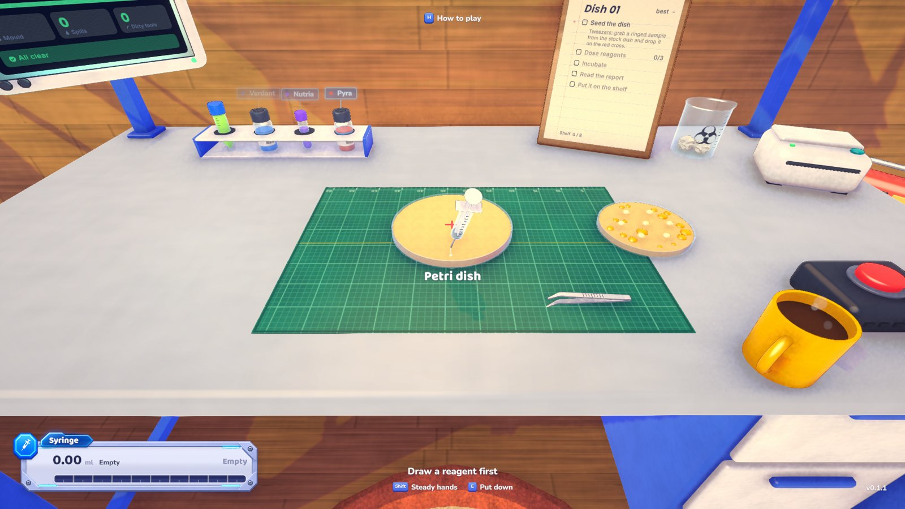
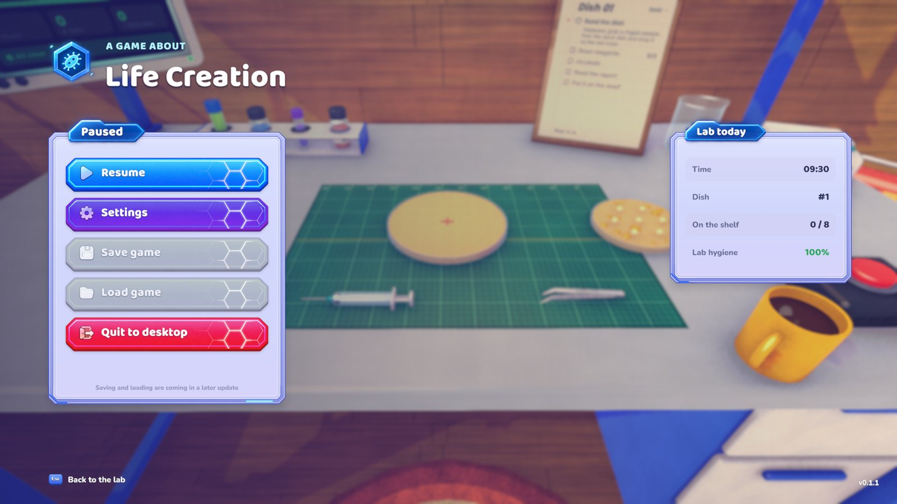
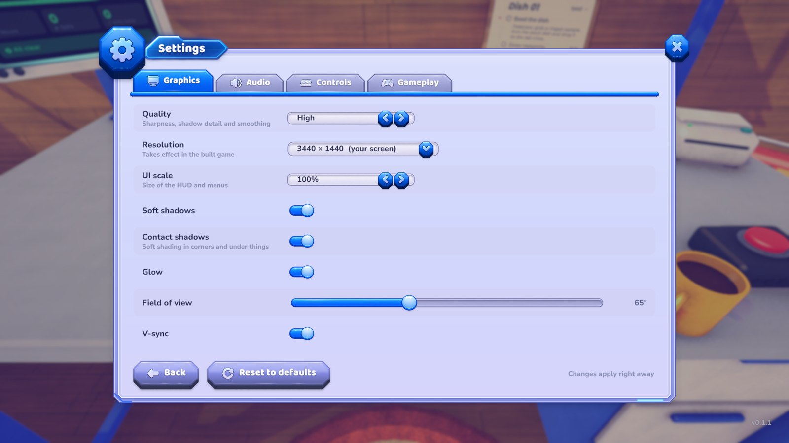

# Life Creation

Grow life in a petri dish. Seed a culture with the tweezers, dose it with reagents from the vials, keep the bench
clean, and read the report that prints for every dish you incubate.

**Developed by FDRK Group.** Life Creation is in early beta: new versions come out often, and things will change.

## Download and play

1. Go to the [Releases](../../releases) page and download the newest **Windows** zip.
2. Unzip it anywhere, open the folder and double-click **LifeCreation.exe**.

The game isn't signed by a known publisher yet, so Windows may say it protected your PC: click **More info**, then
**Run anyway**. Only run builds downloaded from this repository's Releases page.

**Needs:** Windows 10 or 11, 64-bit.

## Controls

| Action | Input |
|---|---|
| Walk | W A S D |
| Stand up / sit back down | Space / E |
| Pick up or put down | E |
| Use the tool (syringe, tweezers) | Left mouse button |
| Lean in | Right mouse button |
| Steady hands | Shift (hold) |
| Look around | Mouse |
| Let a specimen go | X |
| Fresh dish | R |
| How to play | H |
| Pause and settings | Esc |

Settings let you change the graphics quality, resolution and UI size, the volume and the mouse sensitivity.

## More screenshots

| Pause menu | Settings |
|---|---|
|  |  |

## Versions

Every version is on the [Releases](../../releases) page, and [CHANGELOG.md](CHANGELOG.md) lists what changed in each one.

## Feedback

If you hit a bug or have an idea, [open an issue](../../issues).

## License

All rights reserved, © 2026 Donát Fodor. The game and its art may not be copied, reused or redistributed without
permission.

The game uses the Baloo 2 and Nunito fonts, under the SIL Open Font License. Their licence files are in
[licenses](licenses).
